# E-Commerce Backend: Phase 1 Requirements and System Design

Status: **Phase 4 complete** (reports at the end). Phase 3 (full schema) is now delivered incrementally: each module adds its own Flyway migration when it is built (V2 = refresh tokens).

---

## 1. Goal and scope

A REST backend (`/api/v1`) for three kinds of client:

| Client | Users | Typical calls |
|--------|-------|---------------|
| Flutter mobile app | Customers, delivery riders | Browse, cart, checkout, pay, track orders; riders update deliveries |
| Web storefront | Customers | Same as mobile |
| Admin dashboard (web) | Super admins, admins, sellers | Catalog, stock, orders, coupons, users, reports |

The backend is a **modular monolith**: one deployable, split into modules with explicit boundaries so a module
can later move into its own service.

### Starting point

The repository already contains a working single-vendor shop (users, roles, categories, products, cart,
orders, simulated payment, audit log). As of the last change it serves Thymeleaf pages, not a JSON API. The
plan reuses the parts that still fit (security helpers, audit, pricing, the locking checkout logic, tests) and
replaces the rest. The current database has no production data, so the schema starts fresh with Flyway.

---

## 2. Technology choices

| Concern | Choice | Notes |
|---------|--------|-------|
| Language / build | Java 21, Maven wrapper | |
| Framework | **Spring Boot 4.1** (see decision D1) | The brief says 3.x. The 3.x line is no longer in open-source support, and the project already runs on 4.1. |
| Database | PostgreSQL 17 | `jsonb` for flexible data, partial indexes for soft delete |
| Migrations | Flyway | `V1__baseline.sql` and onward; Hibernate runs in `validate` mode only |
| ORM | Spring Data JPA / Hibernate 7 | |
| Security | Spring Security, JWT access tokens (jjwt), refresh tokens stored hashed in the database, BCrypt | |
| Rate limiting | Bucket4j with Redis | Per IP and per account on sensitive endpoints |
| Cache | Redis (Spring Cache) | Catalog reads, category tree, coupon lookups |
| Object storage | S3 API (AWS S3 in production, RustFS in Docker Compose; MinIO stopped publishing Docker images) | Pre-signed upload URLs; the API never streams image bytes |
| Mapping | MapStruct | Entity to DTO |
| API docs | springdoc-openapi (Swagger UI) | Per-module tags, bearer-auth scheme, error examples |
| Tests | JUnit 5, Mockito, Testcontainers (PostgreSQL, Redis) | Docker Desktop is installed on the dev machine |
| Observability | Actuator (health, info, metrics, Prometheus), SLF4J / Logback with a request-id in every log line | |
| Packaging | Dockerfile (layered jar, non-root) and Docker Compose (API, PostgreSQL, Redis, RustFS) | |

---

## 3. Architecture

### 3.1 Module map

```
identity ─────────────┐  (users, roles, tokens; used by every module through CurrentUser)
customer  address     │
catalog (category, brand, product, variant, attribute, image)
inventory ◄──────── order (reserve / commit / release stock)
cart ──► catalog, inventory (read)        wishlist ──► catalog
order ──► cart, pricing, promotion, inventory, shipping
payment ◄──► order (events)               shipping ◄──► order (events)
review ──► order (verified purchase)      notification ◄── events from every module
report (read-only queries)                audit ◄── events from every module
```

**Rules**

1. A module only talks to another module through that module's public service interface or by publishing a
   domain event. It never uses another module's repositories or entities.
2. Cross-module side effects run on Spring application events (`OrderPlaced`, `PaymentCaptured`,
   `OrderCancelled`, `ShipmentDelivered`...). Notifications, audit and reports listen; they never block the
   main transaction (`@TransactionalEventListener(phase = AFTER_COMMIT)`).
3. Spring Modulith's verification test enforces rules 1 and 2 in the build, so a forbidden dependency fails `mvn test`.

### 3.2 Package layout (per module)

```
src/main/java/org/example/panhabackend
├── shared/                 ApiResponse, PageResponse, error codes, exceptions, BaseEntity, Money, CurrentUser
├── config/                 Security, OpenAPI, Redis, S3, Jackson, rate-limit configuration
└── modules/
    └── catalog/                       (same shape for every module)
        ├── api/                       REST controllers + request/response DTOs (records)
        ├── application/               Service interfaces + implementations, MapStruct mappers, events
        ├── domain/                    JPA entities, enums, repositories (package-private where possible)
        └── CatalogModule.java         The module's public API (what other modules may call)
```

Controllers only validate input, call one application service and map the result. Business rules live in
`application/` services and, where it fits naturally, on the entities (for example `Order.cancel()` checks
which transitions are allowed).

### 3.3 API conventions

* Base path `/api/v1`. Plural nouns, `kebab-case` paths, JSON in `camelCase`.
* Status codes: `200` read/update, `201` create (with `Location`), `204` delete, `400` validation,
  `401` not signed in, `403` not allowed, `404` not found (also for other users' resources), `409` business
  conflict (out of stock, invalid status change, duplicate), `422` well-formed but rejected payment,
  `429` rate limited.
* **Success response**

  ```json
  { "success": true, "data": { "id": 42, "name": "Desk Lamp" }, "message": null, "timestamp": "2026-11-11T08:00:00Z" }
  ```

  Lists use `data: { "items": [...], "page": 0, "size": 20, "totalElements": 135, "totalPages": 7 }`.

* **Error response**: a stable machine-readable `code`, so the Flutter app can show the right message
  without parsing text.

  ```json
  {
    "success": false,
    "error": {
      "code": "INSUFFICIENT_STOCK",
      "message": "Some items are no longer available in the requested quantity",
      "details": [{ "field": "items[0].quantity", "message": "Only 2 left" }],
      "path": "/api/v1/orders",
      "traceId": "a1b2c3d4"
    },
    "timestamp": "2026-11-11T08:00:00Z"
  }
  ```

* Pagination, sorting and filtering: `?page=0&size=20&sort=price,asc` (`size` is capped at 100; `sort`
  fields are whitelisted per endpoint) and filters as query parameters
  (`?categoryId=3&brandId=7&minPrice=10&maxPrice=50&inStock=true&q=lamp`).
* Idempotency: `POST /orders` and `POST /payments` accept an `Idempotency-Key` header, so a retried
  request from a flaky mobile connection never creates a second order or charge.
* Money is `BigDecimal` with scale 2 in Java, `NUMERIC(12,2)` in PostgreSQL, a string in JSON (`"19.90"`)
  so JavaScript clients never round it, and always comes with a `currency`.
* Times are UTC `Instant`s in ISO-8601. Clients convert them to local time.

---

## 4. Security design

### 4.1 Tokens

| Token | Format | Lifetime | Storage |
|-------|--------|----------|---------|
| Access | JWT (HMAC-SHA, strength from the key length), claims: `sub` user id, `roles`, `ver` token version, `jti` | 15 min | Client memory |
| Refresh | Opaque 256-bit random string | 30 days, rotated on every use | SHA-256 hash in `refresh_tokens` |

* **Rotation with reuse detection.** Each refresh issues a new pair and marks the old refresh token
  `replaced_by`. If an already-used refresh token comes back, the whole token family is revoked: it was stolen.
* **Revocation.** `users.token_version` is in every access token. Logout-all, password change or reset,
  disabling an account and role changes increment it, so every outstanding access token stops working at once.
  The current version is cached in Redis to avoid a database read per request.
* Passwords use BCrypt (strength 12). Password reset uses a single-use hashed token that expires after 30 minutes.

### 4.2 Roles (RBAC)

| Capability | SUPER_ADMIN | ADMIN | SELLER | DELIVERY | CUSTOMER |
|------------|:-:|:-:|:-:|:-:|:-:|
| Manage admins and roles | ✓ | | | | |
| Manage users and customers | ✓ | ✓ | | | |
| Categories, brands, attributes | ✓ | ✓ | | | |
| Products, variants, images, stock | ✓ | ✓ | own products | | |
| View and fulfil orders | ✓ | ✓ | own order lines | assigned shipments | own orders |
| Coupons and promotions | ✓ | ✓ | | | |
| Update delivery status | ✓ | ✓ | | assigned only | |
| Cart, wishlist, checkout, reviews | | | | | ✓ |
| Reports and dashboard | ✓ | ✓ | own sales | | |
| Audit log | ✓ | ✓ | | | |

URL rules give coarse protection (`/api/v1/admin/**` needs ADMIN or SUPER_ADMIN). `@PreAuthorize` plus
ownership checks in services give the fine-grained rules ("seller may only edit own products"). Ownership
failures return `404`, not `403`, so ids cannot be probed.

### 4.3 Other controls

* CORS: allowed origins from configuration (web storefront and admin dashboard domains). Mobile apps are not
  affected by CORS.
* Rate limits (Bucket4j and Redis):
  * login: 5 per minute per IP plus account
  * register and forgot-password: 3 per minute per IP
  * refresh: 30 per minute
  * checkout and payment: 10 per minute per user
  * Exceeding a limit returns `429` with a `Retry-After` header.
* Validation: Jakarta Bean Validation on every request DTO; HTML is stripped from free text such as reviews.
* SQL injection: only parameterised JPA, Criteria and Specification queries; sort fields come from a whitelist.
* Payment data: card data never reaches this server. Payment providers tokenize it on the client, and the
  API only stores provider references. Webhooks are checked against the provider's signature.
* Secrets come from environment variables (or a secret manager in production); nothing secret is committed.
* Every response hides internals: no stack traces, SQL or entity dumps.

---

## 5. Database design (ERD)

```mermaid
erDiagram
    users ||--o{ user_roles : has
    roles ||--o{ user_roles : grants
    users ||--o{ refresh_tokens : owns
    users ||--o| customer_profiles : "is a customer"
    users ||--o| sellers : "is a seller"
    users ||--o{ addresses : saves

    categories ||--o{ categories : "parent of"
    categories ||--o{ products : contains
    brands ||--o{ products : makes
    sellers ||--o{ products : sells
    products ||--|{ product_variants : "offered as"
    products ||--o{ product_images : shows
    product_variants ||--o{ product_images : "shown by"
    attributes ||--|{ attribute_values : defines
    product_variants ||--o{ variant_attribute_values : "described by"
    attribute_values ||--o{ variant_attribute_values : describes
    product_variants ||--|| inventory : "stocked as"
    product_variants ||--o{ stock_movements : "moved by"

    users ||--o| carts : has
    carts ||--o{ cart_items : contains
    product_variants ||--o{ cart_items : "added as"
    users ||--o{ wishlist_items : saves
    products ||--o{ wishlist_items : "saved as"

    users ||--o{ orders : places
    orders ||--|{ order_items : contains
    product_variants ||--o{ order_items : "sold as"
    sellers ||--o{ order_items : fulfils
    orders ||--o{ order_status_history : records
    orders ||--o{ payments : "paid by"
    payments ||--o{ refunds : "refunded by"
    orders ||--o{ shipments : "shipped in"
    users ||--o{ shipments : "delivers (rider)"
    shipping_methods ||--o{ orders : "chosen for"

    coupons ||--o{ coupon_redemptions : "used in"
    orders ||--o| coupon_redemptions : applies
    users ||--o{ coupon_redemptions : redeems

    products ||--o{ reviews : receives
    users ||--o{ reviews : writes
    order_items ||--o| reviews : "verifies"

    users ||--o{ notifications : receives
    users ||--o{ audit_logs : performs

    users {
        bigint id PK
        varchar email UK "case-insensitive unique"
        varchar phone UK "nullable"
        varchar password_hash
        varchar status "ACTIVE | DISABLED | PENDING_VERIFICATION"
        int token_version
        timestamptz email_verified_at
        timestamptz last_login_at
        timestamptz deleted_at "soft delete"
    }
    roles { smallint id PK
        varchar name UK "SUPER_ADMIN ADMIN SELLER CUSTOMER DELIVERY" }
    refresh_tokens {
        bigint id PK
        bigint user_id FK
        char token_hash UK
        uuid family_id
        timestamptz expires_at
        timestamptz revoked_at
        bigint replaced_by FK
        varchar device_info
    }
    customer_profiles {
        bigint user_id PK, FK
        varchar full_name
        date date_of_birth
        varchar avatar_key
    }
    sellers {
        bigint id PK
        bigint user_id FK, UK
        varchar shop_name
        varchar slug UK
        varchar status "PENDING | ACTIVE | SUSPENDED"
        numeric commission_rate
    }
    addresses {
        bigint id PK
        bigint user_id FK
        varchar label
        varchar recipient_name
        varchar phone
        varchar line1
        varchar line2
        varchar city
        varchar state
        varchar postal_code
        char country_code
        boolean is_default "one per user (partial unique index)"
        timestamptz deleted_at
    }
    categories {
        bigint id PK
        bigint parent_id FK
        varchar name
        varchar slug UK
        int sort_order
        boolean active
    }
    brands { bigint id PK
        varchar name UK
        varchar slug UK
        varchar logo_key
        boolean active }
    products {
        bigint id PK
        bigint seller_id FK
        bigint category_id FK
        bigint brand_id FK "nullable"
        varchar name
        varchar slug UK
        text description
        varchar status "DRAFT | ACTIVE | ARCHIVED"
        numeric rating_avg "denormalised"
        int rating_count
        tsvector search_vector "full-text search"
        timestamptz deleted_at
    }
    product_variants {
        bigint id PK
        bigint product_id FK
        varchar sku UK
        varchar name "e.g. Red / XL"
        numeric price
        numeric compare_at_price "was-price, nullable"
        int weight_grams
        boolean active
        timestamptz deleted_at
    }
    attributes { bigint id PK
        varchar name UK "Color, Size" }
    attribute_values { bigint id PK
        bigint attribute_id FK
        varchar value "UK with attribute_id" }
    variant_attribute_values { bigint variant_id PK, FK
        bigint attribute_value_id PK, FK }
    product_images {
        bigint id PK
        bigint product_id FK
        bigint variant_id FK "nullable"
        varchar storage_key
        varchar alt_text
        int sort_order
        boolean is_primary
    }
    inventory {
        bigint variant_id PK, FK
        int on_hand "CHECK >= 0"
        int reserved "CHECK 0 <= reserved <= on_hand"
        int low_stock_threshold
        bigint version
    }
    stock_movements {
        bigint id PK
        bigint variant_id FK
        varchar type "RECEIVE | ADJUST | RESERVE | RELEASE | COMMIT | RETURN"
        int quantity
        varchar reference_type
        bigint reference_id
        bigint actor_id FK
        timestamptz created_at
    }
    carts { bigint id PK
        bigint user_id FK, UK }
    cart_items { bigint id PK
        bigint cart_id FK
        bigint variant_id FK "UK with cart_id"
        int quantity }
    wishlist_items { bigint user_id PK, FK
        bigint product_id PK, FK
        timestamptz created_at }
    orders {
        bigint id PK
        varchar order_number UK
        bigint user_id FK
        varchar status
        varchar currency
        numeric subtotal
        numeric discount_total
        numeric shipping_total
        numeric tax_total
        numeric grand_total
        bigint shipping_method_id FK
        jsonb shipping_address "snapshot"
        varchar idempotency_key UK
        timestamptz reserved_until "unpaid orders expire"
        bigint version "optimistic lock"
    }
    order_items {
        bigint id PK
        bigint order_id FK
        bigint variant_id FK
        bigint seller_id FK
        varchar product_name "snapshot"
        varchar variant_name "snapshot"
        varchar sku "snapshot"
        numeric unit_price
        int quantity
        numeric discount_amount
        numeric line_total
    }
    order_status_history { bigint id PK
        bigint order_id FK
        varchar from_status
        varchar to_status
        bigint changed_by FK
        varchar note
        timestamptz created_at }
    payments {
        bigint id PK
        bigint order_id FK
        varchar provider "SIMULATED | STRIPE | ..."
        varchar method "CARD | BANK_TRANSFER | COD | WALLET"
        varchar status "PENDING | AUTHORIZED | CAPTURED | FAILED | REFUNDED | PARTIALLY_REFUNDED"
        numeric amount
        varchar provider_reference UK
        varchar idempotency_key UK
        varchar failure_code
    }
    refunds { bigint id PK
        bigint payment_id FK
        numeric amount
        varchar reason
        varchar status
        varchar provider_reference }
    shipping_methods { bigint id PK
        varchar code UK
        varchar name
        numeric base_fee
        numeric free_over
        int eta_days_min
        int eta_days_max
        boolean active }
    shipments {
        bigint id PK
        bigint order_id FK
        bigint rider_id FK "DELIVERY user, nullable"
        varchar carrier
        varchar tracking_number
        varchar status "PENDING | ASSIGNED | PICKED_UP | IN_TRANSIT | DELIVERED | FAILED | RETURNED"
        timestamptz shipped_at
        timestamptz delivered_at
        varchar proof_of_delivery_key
    }
    coupons {
        bigint id PK
        varchar code UK "stored upper case"
        varchar type "PERCENTAGE | FIXED_AMOUNT | FREE_SHIPPING"
        numeric value
        numeric max_discount
        numeric min_order_amount
        timestamptz starts_at
        timestamptz ends_at
        int usage_limit
        int per_user_limit
        int used_count
        boolean active
    }
    coupon_redemptions { bigint id PK
        bigint coupon_id FK
        bigint user_id FK
        bigint order_id FK, UK
        numeric discount_amount
        timestamptz created_at }
    reviews {
        bigint id PK
        bigint product_id FK
        bigint user_id FK
        bigint order_item_id FK, UK "verified purchase"
        smallint rating "CHECK 1-5"
        varchar title
        text body
        varchar status "PENDING | APPROVED | REJECTED"
    }
    notifications { bigint id PK
        bigint user_id FK
        varchar type
        varchar title
        text body
        jsonb data
        timestamptz read_at
        timestamptz created_at }
    audit_logs { bigint id PK
        bigint actor_id FK
        varchar action
        varchar entity_type
        bigint entity_id
        jsonb changes
        varchar ip_address
        varchar trace_id
        timestamptz created_at }
```



Every table also has `created_at` and `updated_at` (`timestamptz`, set by the application). They are left out
of the diagram for readability.

### 5.1 Relationships explained

* **Users and roles.** One `users` table for everyone. A user has one or more roles (`user_roles`). A
  customer also has a `customer_profiles` row; a seller has a `sellers` row with shop data. Riders are users
  with the DELIVERY role.
* **Catalog.** Categories form a tree (`parent_id`). A product belongs to one category, optionally one brand,
  and one seller. **What is sold is a variant, not a product.** Every product has at least one
  `product_variants` row with its own SKU and price; a product without options has one default variant.
  Variants are described by attribute values (Color = Red, Size = XL) through `variant_attribute_values`.
  Images belong to a product, and optionally to one variant (the red shirt's photos).
* **Inventory** has one row per variant. `on_hand` is physically in stock; `reserved` is promised to
  unpaid or unshipped orders; *available* = `on_hand - reserved`. Every change is also written to
  `stock_movements`, so the stock level can always be explained and audited.
* **Cart and wishlist.** One cart per user, lines point at variants (quantity, unique per variant). Wishlist
  entries point at products.
* **Orders** copy everything that can change later into the order: product, variant name, SKU, unit price,
  shipping address (as `jsonb`). Editing the catalog or deleting an address never changes a past order. Each
  `order_items` row records its seller, so a marketplace order with items from several sellers can be
  reported and paid out per seller. `order_status_history` keeps every transition with who made it.
* **Payments.** An order can have several payment attempts (a failed card, then a successful one); refunds
  hang off the payment they reverse.
* **Shipments.** An order has one or more shipments (one per seller when items ship separately), optionally
  assigned to a rider.
* **Coupons.** `coupon_redemptions` links a coupon, a user and an order. It is unique per order and counted
  per user to enforce per-user limits.
* **Reviews** require a delivered `order_items` row (verified purchase), at most one review per order line.

### 5.2 Constraints, indexes and soft delete

* Unique: `lower(users.email)`, `product_variants.sku`, `products.slug`, `categories.slug`, `coupons.code`,
  `orders.order_number`, `payments.provider_reference`, idempotency keys, `(cart_id, variant_id)`.
* Soft delete (`deleted_at`) for users, products, variants and addresses, because orders and reviews must
  keep referring to them. Unique constraints are partial indexes `WHERE deleted_at IS NULL`, so a deleted
  SKU can be reused.
* Indexes:
  * every foreign key
  * `orders(user_id, created_at DESC)`, `orders(status, created_at)`
  * `products(category_id, status)`, `products(seller_id)`
  * GIN on `products.search_vector`
  * `notifications(user_id, read_at)`, `audit_logs(entity_type, entity_id)`
  * `inventory` with a partial index for low stock
* `CHECK` constraints: non-negative money and stock, `reserved <= on_hand`, rating 1-5, coupon value ranges.

### 5.3 Preventing overselling

Stock is reserved with a single conditional update per variant, inside the checkout transaction, in variant-id
order (a fixed order prevents deadlocks):

```sql
UPDATE inventory
   SET reserved = reserved + :qty, version = version + 1, updated_at = now()
 WHERE variant_id = :variantId
   AND on_hand - reserved >= :qty;
```

If any update changes 0 rows, the whole checkout rolls back with `409 INSUFFICIENT_STOCK`. The check and the
write are one atomic statement, so two customers racing for the last unit cannot both succeed, without
holding explicit row locks across the request.

The reservation then moves through the order lifecycle:

| Event | Inventory change |
|-------|------------------|
| Order placed (online payment) | `reserved += qty`; order `reserved_until = now + 30 min` |
| Payment captured | nothing yet (stock stays reserved until it ships) |
| Shipped | `on_hand -= qty`, `reserved -= qty` (COMMIT) |
| Cancelled, payment failed or reservation expired | `reserved -= qty` (RELEASE) |
| Returned after delivery | `on_hand += qty` (RETURN) |

A scheduled job releases expired reservations of unpaid orders. It uses `FOR UPDATE SKIP LOCKED`, so it is
safe to run on several instances.

---

## 6. Business flows

### 6.1 Order lifecycle

```
                      payment captured            seller/admin             rider/admin
PENDING_PAYMENT ─────────────────────────► PAID ──────────► PROCESSING ──► SHIPPED ──► DELIVERED
     │   └── COD: placed directly as ─────────────────────────┘                            │
     │                                                                                     ▼
     ├── payment failed / expired ──► CANCELLED              return accepted ──► RETURNED / REFUNDED
     └── cancelled by customer or admin (before SHIPPED) ──► CANCELLED (+ refund if paid)
```

Transitions live in one place (`OrderStatus` with an allowed-transition table). Any other change returns
`409 INVALID_ORDER_TRANSITION`. Every transition writes `order_status_history` and publishes an event.

### 6.2 Checkout

These steps run in one transaction:

1. Load the cart and re-read current prices.
2. Validate and apply the coupon.
3. Compute shipping.
4. Reserve stock (5.3).
5. Create the order and its snapshots.
6. Record the coupon redemption.
7. Empty the cart.
8. Publish `OrderPlaced` after commit.

The same `Idempotency-Key` returns the order created the first time.

### 6.3 Payment

`PaymentGateway` is an interface with `createPayment`, `capture`, `refund` and `parseWebhook`.

* Phase 10 ships `SimulatedGateway`, which behaves like the current one: a test card is always declined.
* A real provider is an extra implementation selected by configuration (decision D4).
* The client confirms payment with the provider; the provider's signed webhook tells the API the result.
  Order status never depends on the client claiming "I paid".

---

## 7. Non-functional requirements

| Area | Target |
|------|--------|
| Performance | p95 under 200 ms for catalog reads (cached), under 500 ms for checkout, on a single instance |
| Scalability | Stateless API (JWT) so instances scale horizontally; Redis is shared; the scheduler is safe to run on every instance |
| Consistency | Money and stock change only inside database transactions; external effects (e-mails, push) run after commit |
| Security | Section 4; dependency scan (OWASP dependency-check) in the build |
| Operability | Health and readiness probes, Prometheus metrics, JSON logs with trace id in production |
| Data protection | Soft delete; account deletion anonymises personal data while keeping orders for accounting |

---

## 8. Endpoint overview (v1)

| Module | Main endpoints |
|--------|----------------|
| Auth | `POST /auth/register`, `/auth/login`, `/auth/refresh`, `/auth/logout`, `/auth/logout-all`, `/auth/forgot-password`, `/auth/reset-password`, `PUT /auth/password` |
| Customer | `GET/PUT /customers/profile`, `GET/POST/PUT/DELETE /customers/addresses[/{id}]`, `PUT /customers/addresses/{id}/default` |
| Catalog (public) | `GET /products`, `GET /products/{idOrSlug}`, `GET /products/{id}/reviews`, `GET /categories` (tree), `GET /brands` |
| Catalog (admin, seller) | `POST/PUT/DELETE /admin/products[/{id}]`, `/admin/products/{id}/variants`, `POST /admin/products/{id}/images/upload-url`, `/admin/categories`, `/admin/brands`, `/admin/attributes` |
| Inventory | `GET /admin/inventory?lowStock=true`, `POST /admin/inventory/{variantId}/adjustments`, `GET /admin/inventory/{variantId}/movements` |
| Cart | `GET /cart`, `POST /cart/items`, `PATCH /cart/items/{id}`, `DELETE /cart/items/{id}`, `DELETE /cart`, `POST /cart/coupon` (preview) |
| Wishlist | `GET /wishlist`, `PUT /wishlist/{productId}`, `DELETE /wishlist/{productId}` |
| Orders | `POST /orders` (checkout), `GET /orders`, `GET /orders/{id}`, `POST /orders/{id}/cancel` |
| Payments | `POST /payments` (start), `GET /payments/{id}`, `POST /payments/webhooks/{provider}` |
| Shipping | `GET /shipping/methods`, `GET /orders/{id}/shipments`, `PATCH /delivery/shipments/{id}/status` (rider) |
| Coupons | `POST/PUT/GET /admin/coupons`, `POST /coupons/validate` |
| Reviews | `POST /products/{id}/reviews`, `PATCH /admin/reviews/{id}` (moderate) |
| Notifications | `GET /notifications`, `PATCH /notifications/{id}/read`, `POST /notifications/read-all`, `PUT /devices` (FCM token) |
| Admin | `GET/PATCH /admin/users[/{id}]`, `GET /admin/orders`, `PATCH /admin/orders/{id}/status`, `POST /admin/orders/{id}/shipments`, `GET /admin/dashboard` |
| Reports | `GET /admin/reports/sales?from&to&groupBy=day`, `/admin/reports/top-products`, `/admin/reports/low-stock`, CSV export |
| Audit | `GET /admin/audit-logs` |

All paths are relative to `/api/v1`.

---

## 9. Delivery plan

Each phase ends with:

* a green `./mvnw verify`, with unit tests and Testcontainers integration tests on real PostgreSQL and Redis
* updated Swagger
* example requests in `docs/api/`
* a short phase report

Then I stop for your review before the next phase.

| Phase | Delivers | Done when |
|-------|----------|-----------|
| 2 Project setup ✅ | Package layout, PostgreSQL + Flyway baseline, Redis, S3 storage (RustFS), Docker Compose, `ApiResponse` / errors, OpenAPI, Testcontainers base test, Modulith verification. **Removes the Thymeleaf web layer.** | App starts against Compose; health green; architecture test passes |
| 3 Database | Flyway `V1` with the full schema above, seed roles and super admin | `ddl-auto=validate` passes; migration test on a clean container |
| 4 Auth ✅ | Register, login, refresh rotation with reuse detection, logout, password reset, rate limits, RBAC | Token, refresh-reuse and 401/403/429 tests pass |
| 5 Users and customers | Profile, addresses, admin user management, seller onboarding | |
| 6 Catalog | Categories tree, brands, attributes, products, variants, images (pre-signed S3), search and filters, caching | |
| 7 Inventory | Adjustments, movements, low-stock, reservation service | Concurrent-checkout test: 50 parallel buyers for 10 units sell exactly 10 |
| 8 Cart and wishlist | | |
| 9 Checkout and orders | Checkout, idempotency, status machine, history, expiry job | |
| 10 Payment and delivery | Gateway interface, simulated gateway, webhooks, shipments, rider flow | |
| 11 Promotions | Coupons, validation, redemption limits | |
| 12 Admin | Dashboard metrics, reports, CSV export, review moderation, notifications | |
| 13 Testing and optimisation | Coverage gaps, query review (N+1, indexes), load test of catalog and checkout | |
| 14 Production | Hardened Docker image, Compose for prod, env reference, backup notes, CI workflow | |

---

## 10. Decisions

| # | Decision | Outcome |
|---|----------|---------|
| D1 | Spring Boot 3.x (as in the brief) or stay on 4.1 | **Decided: stay on 4.1.** The 3.x line is out of open-source support. |
| D2 | What happens to the Thymeleaf pages built in the last step | **Decided: remove them** in Phase 2. Clients (Flutter, web storefront, admin dashboard) use the JSON API. |
| D3 | Single shop or marketplace with independent sellers | **Decided: marketplace-ready.** Sellers own products and see only their order lines. Orders are not split into sub-orders until it is needed. |
| D4 | Real payment provider for Phase 10 | Open until Phase 10. Options: Stripe (international cards) or ABA PayWay / Bakong KHQR (local Cambodian payments). The simulated gateway is built first in either case. |
| D5 | MySQL support | **Dropped:** PostgreSQL only, as in the brief. Flyway scripts and full-text search are PostgreSQL-specific. |

---

## Phase 2 report (project setup)

**Delivered**

* Package `com.example.ecommerce` with `common/` (config, exception, response, security, persistence) and
  one folder per module under `modules/`. The empty modules (customer, inventory, payment, promotion,
  delivery) exist as declared modules so their boundaries are enforced from the start.
* PostgreSQL only, schema owned by Flyway (`db/migration/V1__baseline.sql`), Hibernate in `validate` mode.
* Redis (Spring Cache configured; caches arrive with the catalog in Phase 6).
* S3 storage client (AWS SDK v2) with pre-signer; RustFS in Docker Compose. MinIO stopped publishing
  Docker images in 2025, so RustFS (Apache-2.0, S3-compatible) replaces it locally. The code only uses the
  S3 API, so AWS S3 in production needs only configuration.
* Response envelope `ApiResponse`, `PageResponse`, stable `ErrorCode`s, global JSON exception handling,
  JSON 401/403 from the security layer, money serialised as strings.
* Stateless security skeleton with CORS. Only health, info and the API docs are public until Phase 4 adds JWT.
* Swagger UI with the bearer-token scheme; MapStruct and Spring Modulith wired into the build.
* `application.yml` with `dev`, `test` and `prod` profiles; Docker Compose with PostgreSQL 17, Redis 7.4,
  RustFS and the API (container `nhacg1`).
* The Thymeleaf pages, MySQL scripts and H2 were removed (decisions D2, D5).

**Verified**

* `./mvnw test`: 13 tests green on real PostgreSQL 17 and Redis containers (Testcontainers):
  * startup with Flyway and schema validation, seeded roles and admin
  * health and readiness, OpenAPI document
  * 401 error envelope, CORS allowed and rejected origins
  * Redis cache round trip, money as string
  * checkout with row locks, stock return, payment and the new error codes (`PAYMENT_DECLINED`, `INSUFFICIENT_STOCK`)
  * module detection and boundaries
* `docker compose up -d --build`: all four containers healthy, migration applied, storage bucket created,
  `/actuator/health` UP, Swagger UI served, unauthenticated API call answered with the JSON envelope.

**Known and accepted**

* The services carried over from the first version (auth, user, category, product, cart, order, audit) still
  reach into each other's entities and repositories: 205 boundary violations. `ModularityTest` fails if the
  number grows or if `common` gains any dependency on a module. The count goes down as each module is
  rewritten (Phases 4-11) and must reach 0.
* These services have no HTTP endpoints yet; they come back as `/api/v1` controllers module by module.

---

## Phase 4 report (authentication and authorization)

**Delivered**

* `/api/v1/auth`: register, login, refresh, logout, logout-all, me, change password, forgot / reset
  password. Examples in [docs/api/auth.md](api/auth.md), Swagger tag "1. Auth".
* JWT access tokens (15 min) with user id, username, roles and session version; checked on every request
  against `users.token_version` (one primary-key lookup; Redis caching left for Phase 13).
* Opaque refresh tokens (30 days), stored as SHA-256 hashes (`V2__refresh_tokens.sql`), rotated on every
  use, with reuse detection that ends the whole sign-in, and a nightly cleanup of expired tokens.
* Five roles (SUPER_ADMIN > ADMIN through a role hierarchy, SELLER, DELIVERY, CUSTOMER); the bootstrap
  admin is SUPER_ADMIN. `/api/v1/admin/**` needs ADMIN.
* Rate limits per client IP in Redis (fixed window, Lua script) on the public auth endpoints, 429 with
  `Retry-After`; fails open if Redis is down. A Redis counter was chosen over Bucket4j: same behaviour for
  these simple limits, no extra dependency.
* New error codes: `TOKEN_EXPIRED`, `INVALID_TOKEN`, `REFRESH_TOKEN_REUSED`.
* Passwords are checked only in the user module (`UserAccountService`); the auth module never sees a hash.
  Unknown logins cost the same BCrypt time as wrong passwords.

**Verified**

* `./mvnw clean test`: 30 tests green.
  * `AuthApiIntegrationTest` (13): sign-up, validation, login by username and e-mail, wrong passwords, the
    super-admin roles, 401 and 403, rotation and reuse detection, an expired access token sent along with a
    refresh, logout, logout-all across devices, password change, single-use reset tokens, rate limiting.
  * `JwtServiceTest` (4): claims round trip, expiry with clock skew, forged and foreign tokens, weak keys.
* Upgrade of an existing database (V1 → V2, existing admin promoted to SUPER_ADMIN) checked against the
  Docker Compose PostgreSQL, followed by a real login and `/me`.
* Module boundary violations: 205 → 147. `auth` and `common` have none, and the test keeps it that way.
