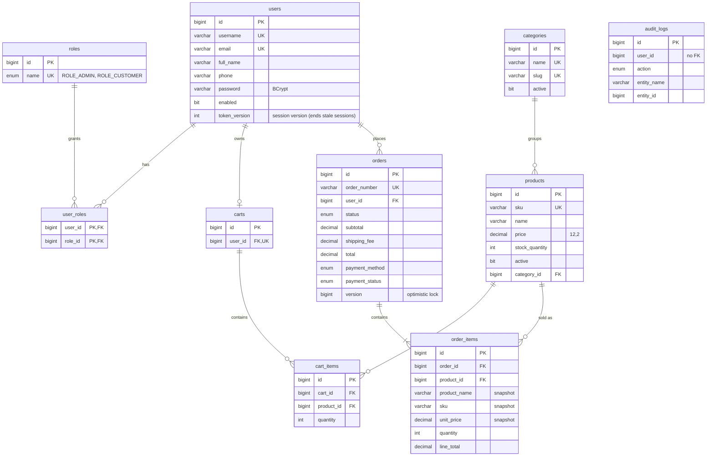

# Entity relationship diagram

MySQL 8, InnoDB, utf8mb4. Every table except `user_roles` and `audit_logs` has `id BIGINT AUTO_INCREMENT`,
`created_at` and `updated_at`. The full DDL is in [`src/main/resources/db/schema.sql`](../src/main/resources/db/schema.sql).

## Tables

| Table | Purpose | Keys and constraints |
|-------|---------|----------------------|
| `users` | Login accounts for admins and customers | `uk_users_username`, `uk_users_email` |
| `roles` | `ROLE_ADMIN`, `ROLE_CUSTOMER` (seeded on startup) | `uk_roles_name` |
| `user_roles` | Many-to-many users ↔ roles | PK (`role_id`, `user_id`) |
| `categories` | Product groups; inactive categories hide their products | `uk_categories_name`, `uk_categories_slug` |
| `products` | Catalog with price and stock | `uk_products_sku`, FK → `categories`, `CHECK price >= 0`, `CHECK stock_quantity >= 0` |
| `carts` | One cart per customer, created on first use | `uk_carts_user` (one-to-one with `users`) |
| `cart_items` | Products and quantities in a cart (no price: always current) | `uk_cart_items_cart_product` (a product appears once per cart), `CHECK quantity > 0` |
| `orders` | Placed orders with totals, shipping address and payment snapshot | `uk_orders_order_number`, FK → `users`, `version` for optimistic locking |
| `order_items` | Order lines with name, SKU and price frozen at checkout | FK → `orders` (cascade delete), FK → `products` |
| `audit_logs` | Append-only trail of who did what | No FKs, so entries survive deletions |

## Relationships and rules

* **users 1 — 0..1 carts.** The cart is created lazily on the first add. It is emptied (not deleted) at checkout.
* **carts 1 — * cart_items — * 1 products.** The `(cart_id, product_id)` unique key means adding a product
  that is already in the cart increases its quantity instead of creating a second line.
* **categories 1 — * products.** A category with products cannot be deleted; deactivate it instead.
* **users 1 — * orders 1 — 1..* order_items.** A user with orders cannot be deleted; disable the account.
* **products 1 — * order_items.** A product that was ever ordered cannot be deleted; deactivate it. The
  reference is kept so a cancellation can return stock to the right product.
* **Money columns** are `DECIMAL(12,2)`. `orders.total = subtotal + shipping_fee`, and
  `order_items.line_total = unit_price × quantity`.

## Indexes

| Index | Used by |
|-------|---------|
| `idx_products_category`, `idx_products_active` | Catalog filters (`categoryId`, customer view of active products) |
| `idx_orders_user` | "My orders" |
| `idx_orders_status`, `idx_orders_created` | Admin order search, newest first |
| `idx_order_items_order`, `idx_order_items_product` | Loading an order's lines, "was this product ever ordered?" |
| `idx_audit_entity`, `idx_audit_user`, `idx_audit_created` | Audit log search |
| `idx_users_enabled` | User search by status |
