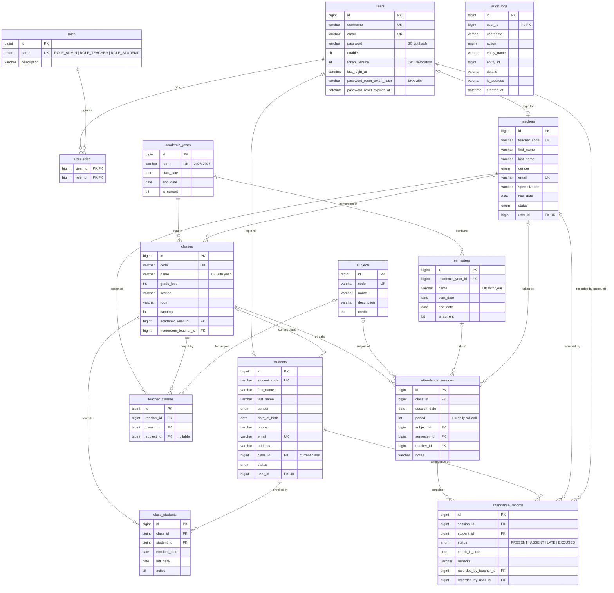

# Database Design: ERD and Relationships

MySQL 8, InnoDB, `utf8mb4`. The DDL is in [`src/main/resources/db/schema.sql`](../src/main/resources/db/schema.sql).
Every table has a surrogate `BIGINT AUTO_INCREMENT` primary key. Every table except `audit_logs` and the
`user_roles` join table has `created_at` / `updated_at` columns, which Hibernate maintains.

## Entity-relationship diagram

## Relationships, table by table

| # | Table | Relationship | Notes |
|---|-------|--------------|-------|
| 1 | **users** | 1 : N `user_roles`; 0..1 : 0..1 `teachers`; 0..1 : 0..1 `students` | A login account. The FK lives on the profile side (`teachers.user_id` and `students.user_id`, both UNIQUE), so profiles can exist before an account is created. |
| 2 | **roles** | 1 : N `user_roles` | Seeded on startup: `ROLE_ADMIN`, `ROLE_TEACHER`, `ROLE_STUDENT`. |
| 3 | **user_roles** | N : M join of users and roles | Composite PK `(role_id, user_id)`. One user can hold several roles. |
| 4 | **students** | N : 1 `classes` (current class); 1 : N `class_students`; 1 : N `attendance_records` | `class_id` is the student's current class, which keeps lookups fast. History is in `class_students`. |
| 5 | **teachers** | 1 : N `teacher_classes`; 0..1 : N `classes` (homeroom); 1 : N `attendance_sessions` and `attendance_records` | |
| 6 | **classes** | N : 1 `academic_years`; N : 0..1 `teachers` (homeroom); 1 : N students, enrollments, assignments, sessions | `UNIQUE(name, academic_year_id)`: "Grade 10 - A" can repeat each year. |
| 7 | **subjects** | 1 : N `teacher_classes`; 1 : N `attendance_sessions` | |
| 8 | **class_students** | N : 1 `classes`, N : 1 `students` | Enrollment history. `UNIQUE(class_id, student_id)`. When a student moves class, the old row is set `active = 0` with a `left_date`. |
| 9 | **teacher_classes** | N : 1 `teachers`, `classes`, `subjects` (optional) | "Teacher X teaches subject Y in class Z". Teachers may only record attendance for classes they are assigned to or are homeroom teacher of. |
| 10 | **attendance_sessions** | N : 1 `classes`, `subjects`, `semesters`, `teachers`; 1 : N `attendance_records` | One roll call. `UNIQUE(class_id, session_date, period)`: exactly one session per class, date and period. `semester_id` is filled in automatically from the session date. |
| 11 | **attendance_records** | N : 1 `attendance_sessions`, `students`, `teachers`, `users` | **`UNIQUE(session_id, student_id)` prevents duplicate attendance** for the same student, class and session, even under concurrent requests. |
| 12 | **academic_years** | 1 : N `semesters`, 1 : N `classes` | The service guarantees that only one row has `is_current = 1`. |
| 13 | **semesters** | N : 1 `academic_years`; 1 : N `attendance_sessions` | Dates must fall inside the academic year. Used for SEMESTER reports. |
| 14 | **audit_logs** | none (deliberately) | Append-only. It stores `user_id` and `username` as plain values, so the trail survives when a user is deleted. |

## Normalization

* **1NF:** every column is atomic. Roles are rows in `user_roles`, not a comma-separated list.
* **2NF / 3NF:** no non-key column depends on part of a key or on another non-key column. A student's class
  name is not stored on the student, and a session's date and class are not repeated on every attendance record.
  Records reference the session instead.
* **Deliberate, controlled denormalization:** `students.class_id` duplicates the active row of `class_students`
  so that "students in class X" is a single indexed lookup. The service layer updates both in one transaction.

## Indexes (beyond PK / UNIQUE / FK)

| Index | Serves |
|-------|--------|
| `students(last_name, first_name)`, `teachers(last_name, first_name)` | Name search and sorting |
| `students(status)`, `teachers(status)` | Dashboard totals for active students and teachers |
| `classes(grade_level)` | Class filtering |
| `attendance_sessions(session_date)` | Date filters, daily, weekly and monthly reports, "today" dashboards |
| `attendance_records(student_id, status)` | Student history and percentage |
| `attendance_records(status)` | Absent and late lists |
| `class_students(class_id, active)` | Active roster of a class |
| `semesters(start_date, end_date)` | Resolving the semester for a date |
| `audit_logs(entity_name, entity_id)`, `(user_id)`, `(created_at)` | Audit search |

MySQL also creates an index for every foreign key automatically.

## Deletion rules

There are no `ON DELETE CASCADE` rules on attendance data. The services refuse with HTTP 409 to delete a
student, teacher, class, subject or semester that attendance history depends on. Set the student or teacher
`status` to `INACTIVE` instead. Rows that are safe to remove (enrollments, assignments) are cleaned up
explicitly inside the same transaction.
